<picture></picture>

<picture></picture>

<a href="https://linliu017-art.github.io/showstart-landing-page/"><strong>ShowStart · 秀动落地页概念 ↗</strong></a>

---

<a href="https://linliu017-art.github.io/website/"><strong>Personal Website · 个人网站 ↗</strong></a>

<picture></picture>

<picture></picture>

<a href="https://mp.weixin.qq.com/s/zNrkW1CvZlaiJXMB8me5MQ"><strong>DeepSeek 能读百万上下文了，我们还需要上下文工程吗？ ↗</strong></a>

---

<a href="https://mp.weixin.qq.com/s/oH2MlMnSexo_oOzLO6mMXA"><strong>端侧 AI 新趋势：从生成走向检索和判断 ↗</strong></a>

