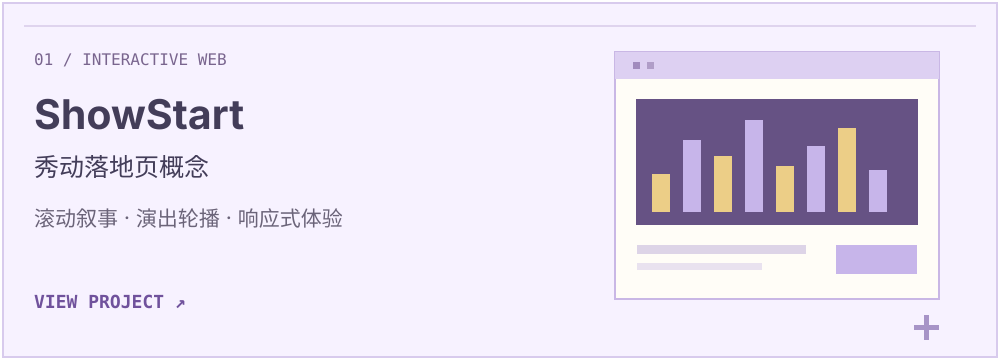
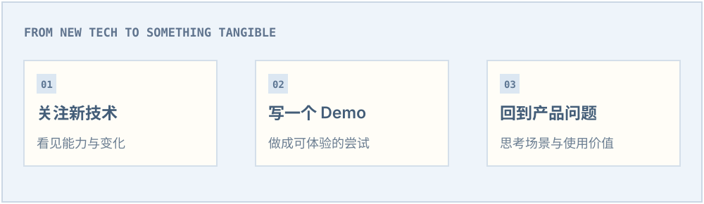

 

围绕演出发现、购票和电子票夹体验制作的非官方产品落地页概念，用滚动叙事和轮播探索音乐现场的网页表达。

`CONCEPT PROJECT` `GSAP` `SWIPER` `RESPONSIVE`

用原生 HTML 与 CSS 搭建的个人空间，作为个人介绍与作品展示的起点，内容持续完善中。[查看仓库 ↗](https://github.com/linliu017-art/website)

`PERSONAL SPACE` `HTML` `CSS`

我会为感兴趣的新技术写 Demo，通过实际体验理解它能做什么，再思考它适合怎样的产品场景。

`NEW TECHNOLOGY` `HANDS-ON DEMOS` `PRODUCT THINKING`

[PROJECT FEEDBACK ↗](https://github.com/linliu017-art/showstart-landing-page/issues) · [GITHUB ↗](https://github.com/linliu017-art)
