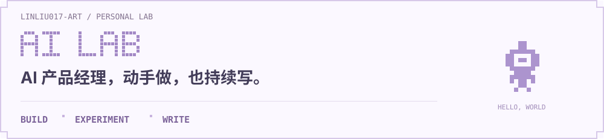

 

<a href="https://github.com/linliu017-art/showstart-landing-page"><strong>ShowStart · 秀动落地页概念 ↗</strong></a> 非官方产品概念 · 滚动叙事 · 演出轮播

---

<a href="https://linliu017-art.github.io/website/"><strong>Personal Website · 个人网站 ↗</strong></a> 个人介绍与作品展示 · HTML / CSS

<a href="https://mp.weixin.qq.com/s/zNrkW1CvZlaiJXMB8me5MQ"><strong>DeepSeek 能读百万上下文了，我们还需要上下文工程吗？ ↗</strong></a> 长上下文 · RAG · 记忆与信息组织

---

<a href="https://mp.weixin.qq.com/s/oH2MlMnSexo_oOzLO6mMXA"><strong>端侧 AI 新趋势：从生成走向检索和判断 ↗</strong></a> 端侧 AI · 多模态检索 · 模型选型

